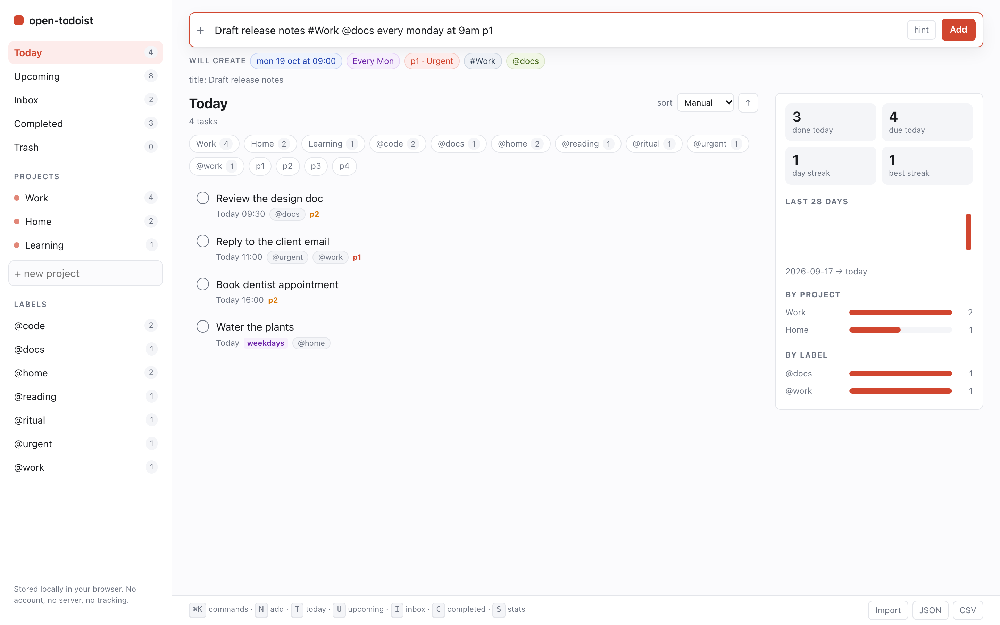
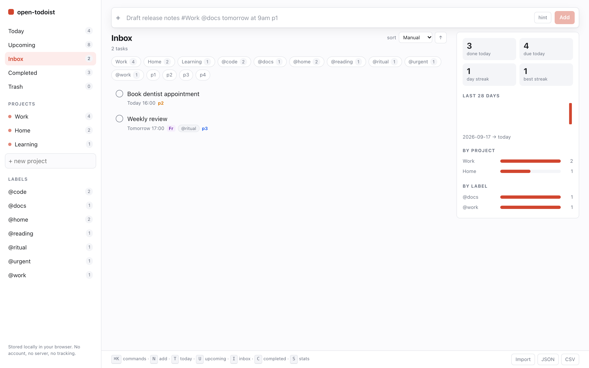

# open-todoist

**A local-first, keyboard-first open source task manager with natural-language
quick add — a Todoist alternative that needs no account, no server and no
network connection.**

[](LICENSE)
[](package.json)
[](package.json)
[](docs/REVERSE_ENGINEERING.md)
[](https://github.com/)

> **Not affiliated with Todoist.** Independent clean-room reimplementation.

## What this is

open-todoist is an **open source Todoist alternative** for people who want a
**task manager** they can trust with their whole list of obligations. You type
`Call the dentist tomorrow at 9am #Health @phone p2`, the app shows you exactly
what it understood *before* you commit, and then the task exists — dated,
timed, prioritised, filed. There is no account, because there is no server.

It is **local-first**: everything lives in your browser's IndexedDB and the
application makes **zero network requests** after load. That makes it a
**privacy-first todo** list, a genuinely **offline task manager**, and a
**minimal todo app** of about 3,700 lines of original TypeScript. It is
self-hosted in the strongest sense — you already have it, in your browser tab.

Put simply: this is an **open source todo app** that a person can read end to
end, and a **natural language task manager** in the strict sense — the text you
type *is* the input format, not a form to be filled in.

It is also **keyboard-first**. Every action has a shortcut, everything is
reachable from a `⌘K` command palette, and the full table is below.

Roughly 3,700 lines of original TypeScript plus 415 lines of CSS, with a
1,073-line test suite alongside them.

### The natural-language quick add

This is the feature the project exists for. One line, parsed as it is typed:

| You type | open-todoist understands |
| --- | --- |
| `Standup tomorrow` | date: tomorrow |
| `Retro next monday` | date: Monday of *next* week |
| `Dentist in 2 weeks` · `Renew passport 3d` | date: +14 days · +3 days |
| `Deploy at 14:00 friday` · `Gym 9am` · `Dinner 7:30pm` | date + clock time |
| `Water plants every weekday` | repeat: Monday–Friday, never weekends |
| `Review every mon,wed,fri` · `Backup every 2 weeks` | repeat: those days, fortnightly |
| `Pay rent monthly` · `Journal daily` · `Review weekly` | repeat: monthly, daily, weekly |
| `Fix outage p1` … `Someday p4` | priority 1 (urgent) … 4 (none) |
| `Write spec #Roadmap` · `写周报 #工作` | project, created if new |
| `Fix login @bug @urgent` | labels |

Combine them freely. `Draft release notes #Work @docs every monday at 9am p1`
creates one fully-formed task. Chinese works the same way: `明天`, `下周三`,
`三天后`, `每天`, `每周五`, `下午3点半`.

**And it shows its work.** As you type, chips appear under the box:



**When it is unsure, it does nothing.** `You may want to check this` keeps every
word — bare `may` is not treated as a month. `Fix the mar floor` keeps `mar`,
because that is ambiguous between Tuesday and March. A leftover word is a
mistake you can see; a silently wrong due date is one you find out about on the
wrong day. This is a real design decision, and it is covered by tests.

## Feature comparison

| Feature | open-todoist | Todoist | Notes |
| --- | --- | --- | --- |
| Natural-language quick add | ✅ | ✅ | Our grammar is independent; 73 tests. |
| Live parse preview before commit | ✅ | ✅ | Chips on every keystroke. |
| Repeats: daily / weekday / weekly-by-day / monthly / yearly | ✅ | ✅ | Repeat rolls forward on completion. |
| Priority tiers | ✅ `p1`–`p4` | ✅ | Same convention, independent code. |
| Projects, labels, Inbox, Today, Upcoming, Completed | ✅ | ✅ | |
| Trash with restore (soft delete) | ✅ | ✅ | |
| Sorting and filtering | ✅ 5 sort keys | ✅ more | No saved custom filters here. |
| Command palette ⌘K, keyboard-first | ✅ | ✅ | |
| Statistics: streak, 28-day sparkline, per-project/label | ✅ | ✅ deeper | Hand-rolled SVG, no chart library. |
| JSON export / import | ✅ round-trip tested | ⚠️ | Documented, plain, pretty-printed JSON. |
| CSV export | ✅ 12 columns | ⚠️ Pro feature | RFC-4180 quoting. |
| Offline | ✅ zero network calls | ⚠️ offline mode | No server to be offline from. |
| **Mobile apps** | ❌ | ✅ | **Biggest gap.** No native app. |
| **Reminders / notifications** | ❌ | ✅ | **Biggest gap.** Due dates are passive. |
| **Calendar, board, Gantt layouts** | ❌ | ✅ | List layout only. |
| **Integrations (100+)** | ❌ | ✅ | |
| **AI assistant features** | ❌ | ✅ | Deliberate: your tasks go nowhere. |
| **Comments, attachments, duration** | ❌ | ✅ | |
| **Team / shared projects** | ❌ | ✅ | Structural, by design. |
| Cross-device sync | ❌ n/a | ✅ | The core trade-off. |
| User accounts | ❌ n/a | ✅ | The core trade-off. |

The full table, including where open-todoist is genuinely better, is in
[docs/COMPARISON.md](docs/COMPARISON.md).

## Why it was built / How it was reverse engineered

Built because the mainstream task managers all require an account, a server and
a network connection, and all three are a poor trade for a private to-do list.

**We did not reverse engineer any proprietary code, and we could not have.** We
used REA to take observations of Todoist's **public web surface**: 78 scripts
(351,479 AST nodes) on the public marketing site, and 5 scripts (1,910 AST
nodes) at `app.todoist.com`, which redirects unauthenticated visitors to a login
shell. That told us the technology fingerprint and the public information
architecture — nothing more. REA returned structural observations, never source
text.

The authenticated app exposes no task-data API to an anonymous session. So this
is architecture and information-architecture forensics of a public web surface,
**not** code reverse engineering. Our product behaviour comes from publicly
observable behaviour and public documentation, plus our own design. Full
accounting, evidence IDs and commands: [docs/REVERSE_ENGINEERING.md](docs/REVERSE_ENGINEERING.md).

## Quick start

```bash
git clone https://github.com/<you>/open-todoist.git
cd open-todoist
npm install
npm run dev        # http://localhost:5173

# verification
npm run build      # tsc --noEmit && vite build
npm test           # 165 tests
```

No configuration, no `.env`, no database to provision. Requires Node 18+.
If `npm install` stalls on a slow network: `npm install --registry=https://registry.npmmirror.com`.

## Screenshots



*(Both screenshots are captures of this application running from its own build,
with sample data, in headless Chrome.)*

## Architecture

```
React UI  ──▶  reducer store  ──▶  pure lib  ──▶  IndexedDB
 components      (useStore)       nlp · recurrence    (or localStorage
                     ▲             filter · stats      fallback)
                     └────── debounced write-through ──────┘
```

The domain layer is pure TypeScript with no React import, which is why all 165
tests run in Node with no DOM shim.

- `src/lib/nlp.ts` — the quick-add scanner (English + Chinese)
- `src/lib/recurrence.ts` — next-fire-date engine, DST- and leap-safe
- `src/lib/db.ts` — ~200-line IndexedDB wrapper, no ORM
- `src/lib/date.ts` — calendar arithmetic; a due day is a *local calendar day*,
  never an epoch instant

Details: [docs/ARCHITECTURE.md](docs/ARCHITECTURE.md).

## Keyboard shortcuts

| Scope | Key | Action |
| --- | --- | --- |
| Global | `⌘K` / `Ctrl-K` | Command palette |
| Global | `N`, `Q` or `/` | Focus quick add |
| Global | `T` | Today view |
| Global | `U` | Upcoming view |
| Global | `I` | Inbox view |
| Global | `C` | Completed view |
| Global | `S` | Toggle statistics |
| Task row | `Space` or `X` | Complete / reopen (repeats roll forward) |
| Task row | `E` | Edit title inline |
| Task row | `1` `2` `3` `4` | Set priority |
| Task row | `Delete` | Move to trash (`Backspace` restores it there) |
| Task row | `↑` `↓` | Reorder manually |

## Roadmap

Honest list. Items are ordered by how much they are actually needed.

**Shipped**
- [x] Natural-language quick add (English + Chinese) with live preview
- [x] Repeats, priorities, projects, labels, soft delete and trash
- [x] All seven views, sorting and filtering
- [x] Command palette and full keyboard control
- [x] JSON import/export, CSV export
- [x] Statistics panel with streak and distributions
- [x] Dark mode via `prefers-color-scheme`

**Next**
- [ ] Optional opt-in reminder notifications (requires permission, still local)
- [ ] Subtasks
- [ ] Drag-and-drop reordering
- [ ] Multiple task-description lines with markdown
- [ ] Attachment-free task templates

**Probably never, and that is the point**
- ❌ Accounts, servers or sync
- ❌ Telemetry of any kind
- ❌ Ads, affiliate links or upsells
- ❌ AI features that transmit your task text anywhere

## FAQ

**Is this a real open source Todoist alternative?**
Yes — MIT-licensed, with natural-language quick add, projects, labels, recurring
tasks, four priorities and seven views. It is narrower than Todoist: no mobile
app, no reminders, no board or calendar layout, no sync. [Full comparison](docs/COMPARISON.md).

**Does it need an account?**
No. No sign-up, no login, no email address, no server to hold any of it.

**Is my data private?**
Your tasks are stored in your browser's IndexedDB and never leave the device.
The app makes no network requests after load, ships no analytics, and its only
runtime dependencies are `react` and `react-dom` — verifiable in `package.json`.

**Will it sync between devices?**
No, and we would rather be blunt about it. Your tasks live in one browser
profile. Export to JSON regularly; that is the backup.

**Does it work offline?**
Completely. There is no API client in the codebase to be offline from.

**Can I use it on my phone?**
The web app is responsive and can go on your home screen, but there is no native
app and no push notifications. If phone access matters, use Todoist.

**What if the parser misreads something?**
It refuses to guess. Ambiguous tokens stay in the title; a clock time with no
date is left in the title. The preview shows exactly what will be created before
you press Enter.

**What happens when I complete a recurring task?**
It rolls forward — the due date advances to the next fire date, keeping the clock
time, and the task stays open.

**How do I back up my data?**
**JSON** in the status bar (or ⌘K) exports everything as a versioned, readable
document; importing it restores it. CSV export is available for spreadsheets.

**Is Todoist affiliated with this?**
No. "Todoist" is a trademark of Doist. open-todoist is independent, unofficial,
unaffiliated, and contains none of their code, assets or brand material. See
[NOTICE.md](NOTICE.md).

More questions: [docs/FAQ.md](docs/FAQ.md).

## Contributing

Issues and pull requests are welcome — especially parser edge cases, which are
the easiest thing to get wrong. Run `npm run build && npm test` before opening a
PR. See [CONTRIBUTING.md](CONTRIBUTING.md) and [CODE_OF_CONDUCT.md](CODE_OF_CONDUCT.md).

## License

MIT — see [LICENSE](LICENSE). Clean-room; see [NOTICE.md](NOTICE.md) for the
trademark and non-affiliation statement.
